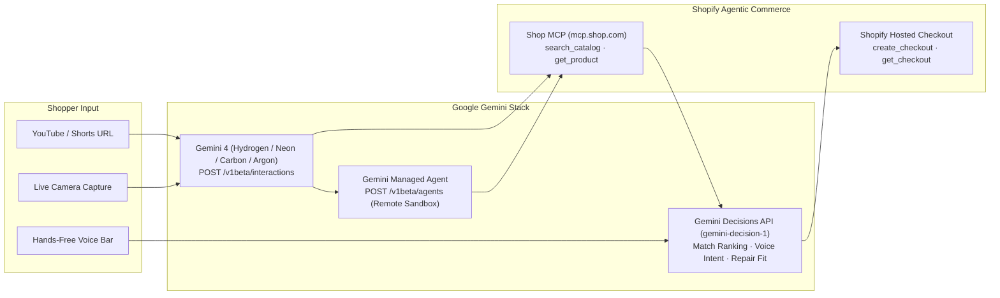

# SceneTrace — Pause the Scene. Shop the Frame.

**Live Production App:** [https://scenetrace.vercel.app](https://scenetrace.vercel.app) · **Live Proof & Eval Record:** [VERIFICATION.md](./VERIFICATION.md)

SceneTrace turns any **public YouTube video / Short** or **live camera capture** into verified, ready-to-buy **Shopify offers**—drivable by text or **hands-free voice**, with an on-demand **Repair vs. Replace** diagnostic when an item looks damaged.

---

## How SceneTrace Uses the Gemini 4 + Shopify Stack

| Layer | Model / Service | What It Does in SceneTrace |
| --- | --- | --- |
| **Multimodal Scene & Still Extraction** | **Gemini 4** (`gemini-4-hydrogen` default, switchable to `gemini-4-neon`, `gemini-4-carbon`, `gemini-4-argon` on `POST /v1beta/interactions`) | Tracks items across video cuts or camera stills, returning exact evidence timestamps (`bestEvidenceSec`), normalized `bestBox2d` crops, provenance-tagged traits (`visible \| spoken \| inferred`), shopper budget/size/color constraints, and visible damage signals. |
| **Autonomous SKU & MSRP Forensics** *(Managed Agents Track)* | **Gemini Managed Agents** (`scenetrace-investigator-v1` on `POST /v1beta/agents`, `antigravity-preview-latest`, `environment: "remote"`) | Runs autonomous multi-step `google_search` + Python `code_execution` inside a hosted Linux container to resolve exact manufacturer SKUs, retail MSRP bands, counterfeit/mismatch price flags, and stateful multi-turn refinements (`previous_interaction_id`). |
| **Zero-Token Probabilistic Ranking, Voice Routing & Fault Scoring** *(Decisions API)* | **Gemini Decisions API** (`gemini-decision-1` on `POST /v1beta/decisions`) | Powers **three** calibrated decision loops: **(1)** variant match ranking (`noul` probabilities over Shopify CDN product photos + hard brand/SKU/color gates), **(2)** low-latency **voice intent routing** with confidence/margin gating, and **(3)** polarity-aware **repair fault + part-fit verification**. |
| **Live Multimodal Catalog & Hosted Checkout** *(Shopify Commerce Track)* | **Shop MCP** (`https://mcp.shop.com/`, protocol `2026-07-28`) | Runs interleaved text + `catalog.like` visual array searches across live Shopify merchants, verifies real-time stock/options/pricing via `get_product`, creates real **Shopify-hosted checkouts** (`create_checkout` → `continue_url`), and polls order completion (`get_checkout`). |
| **Hands-Free Voice & Spoken Feedback** | **Browser Speech + Gemini TTS** (`/api/voice/intent`, `/api/voice/speak`) | Lets shoppers drive the studio end-to-end by voice (*"switch to camera"*, *"under 100 dollars"*, *"is it worth fixing?"*, *"add it to my cart"*) with barge-in support, acoustic echo guarding, and loop protection. |

---

## System Architecture



---

## Key Engineering Highlights

- **Evidence-Grounded UI (No Guesswork)**: Seeks and **pauses** the YouTube player on the exact supporting frame (`bestEvidenceSec`), overlays bounding boxes on camera captures, and refuses `exact_supported` badges unless direct `visible` or `spoken` evidence corroborates the listing.
- **On-Demand Repair vs. Replace Check (`/api/traces/repair`)**: When a camera capture shows wear or the user asks *"is it worth fixing?"*, Gemini 4 generates an item-specific fault question bank, `gemini-decision-1` scores visual fault probabilities and replacement-part fit in a single batched call, and SceneTrace compares part cost vs. full replacement on Shopify.
- **Stateless Cryptographic Checkout Safety**: Offer quotes are signed with **HMAC-SHA256** (`offerToken`) and checkout handles are encrypted with **AES-256-GCM** (`checkoutRef`). `POST /api/checkout` is never cached—it always re-verifies live variant availability, options, and price via `get_product` before creating a hosted checkout, with per-intent UUID idempotency keys and a multi-store **Session Bag**.
- **Built-In Zero-SaaS Traceability & Multi-Layer Caching**: Every request emits secret-free structured JSON spans (`x-scenetrace-id` + Google AI Studio `interactionId` correlation), renders a live **Gantt Span Waterfall** in the **Proof** drawer, persists a 12-run trace history ledger with 1-click JSON export, and serves repeat traces in `<20ms`.

---

## Local Quickstart

1. Copy `.env.example` to `.env` and set your `GEMINI_API_KEY`:
   ```bash
   cp .env.example .env
   ```
2. Install dependencies and start the Next.js dev server:
   ```bash
   pnpm install
   pnpm dev
   ```
3. Open [http://localhost:3000](http://localhost:3000).

---

## Verification & Evaluation Suite

All live smoke outputs and the 3-clip real YouTube evaluation (**3/3 = 100% Decisions Top-1** vs. **2/3 raw Shop order**, promoting exact Casio F-91W variant from `#4 → #1`) are recorded in [VERIFICATION.md](./VERIFICATION.md) and [evals/results/latest.json](./evals/results/latest.json).

```bash
pnpm lint             # ESLint static analysis (0 errors)
pnpm typecheck        # Strict TypeScript check (0 errors)
pnpm test             # 61 unit & regression tests across 5 suites (Vitest)
pnpm build            # Production Next.js / Vercel Serverless build
pnpm smoke:shop       # Live Shop MCP search -> get_product -> create_checkout -> get_checkout
pnpm smoke:decisions  # Live Gemini Decisions API (/v1beta/decisions) rerank check
pnpm smoke:agent      # Live Gemini Managed Agent (/v1beta/agents) remote sandbox check
pnpm smoke:gemini     # Live Gemini 4 Interactions YouTube extraction check
pnpm eval             # Controlled + real YouTube clip evaluation suite
```
