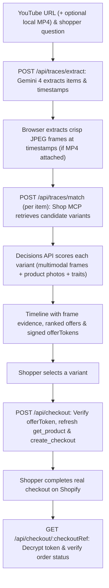

# SceneTrace build plan

Implementation brief for Google Antigravity (AGY), using Gemini 4 Carbon as the coding agent. Prepared for the Gemini 4 NYC Hackathon and the Shopify Build with Commerce bonus track on November 21, 2026.

## 1. Brief for the coding agent

Build a web app that takes a **public YouTube URL (plus an optional companion video/still file) and a shopper’s question**, traces any requested products across the clip, finds and ranks real Shopify offers, and sends the shopper to the selling merchant’s **Shopify-hosted checkout** for a real end-to-end purchase. Watch identification (“Which watches did the person in the blue jacket wear?”) is one great example, alongside shoes, clothing, bags, accessories, or any item sold on Shopify.

Read this plan and the repository instructions first. Use a single TypeScript Next.js App Router app (`pnpm`) with a Node server runtime, React, Tailwind CSS, and Zod for boundary validation. **Start by building and testing locally, then deploy cleanly to Vercel** (Madhu will provide Vercel project details when ready to deploy). Design route handlers and state boundaries to be **100% Vercel serverless-compatible** from the start — avoid single-process detached background Promises or in-memory `Map` stores that break across serverless instances; instead use stateless stage endpoints (within configured Vercel `maxDuration`) and server-signed/encrypted tokens so no external database or queue is needed.

**Build in this order: Phase 0 integration proofs (Shop MCP search + `get_product` + `create_checkout`, Gemini 4 YouTube extraction, Decisions ranking) → YouTube + frame extraction pipeline → Shop MCP catalog retrieval → Decisions API reranking → high-craft dark-mode timeline UI, end-to-end checkout, and Vercel-ready build.** Keep credentials in server-side environment variables. After each milestone, record the command or manual step you ran and what it verified. Take the work through working code and verification.

AGY Carbon is the **coding agent**. The app uses configurable **Gemini 4 Neon (`gemini-4-neon`)** by default for video extraction, **Gemini 4 Carbon (`gemini-4-carbon`)** as an optional high-reasoning runtime extraction model, a persistent **Gemini Managed Agent (`scenetrace-investigator-v1` registered on `POST /v1beta/agents` over `antigravity-preview-latest` with `environment: "remote"`)** for autonomous sandbox SKU/MSRP research and stateful shopper follow-ups, **`gemini-decision-1`** for evidence scoring, and **Shop MCP (`https://mcp.shop.com/`)** for commercial data and checkout. Keep model selection configurable in the UI/env, with the selected model and Managed Agent sandbox telemetry visible in developer diagnostics.

### Core hackathon directives

1. **Local-first, Vercel-deployed**: Demoing on `localhost` is not enough — the app will be deployed on Vercel once verified locally. Ensure YouTube `origin` resolution, serverless `maxDuration`, stateless HMAC/AES-GCM tokens, and client-side frame extraction work identically on `http://localhost:3000` and `https://*.vercel.app`.
2. **High-craft UI, zero “AI slop”, first-class Dark Mode**: The interface must feel intentional, tactile, and bespoke — think Frame.io / Linear / editorial commerce studio rather than a generic AI template. Include **first-class dark mode** (defaulting to a rich studio dark palette with a crisp light/dark toggle), purposeful typography (editorial sans + monospace timecodes), restrained borders/surfaces, and zero purple-gradient SaaS clichés, emoji clutter, or generic card boilerplate.
3. **Working product & output quality first, performance tuning later**: Ship a rock-solid, accurate end-to-end product fast. Defer premature caching, complex batching, or latency micro-optimizations until the full user journey works reliably.
4. **Maximize AI accuracy over token/API cost**: Do not ration tokens, reasoning depth, video frame sampling, `get_product` verification calls, or multimodal image inputs during the hackathon. Use rich prompts, strong reasoning/sampling settings, and multimodal frame + product photo comparisons whenever they improve identification and ranking quality.

## 2. Product behavior and definition of done

| Stage | User-visible behavior | Source of truth |
|---|---|---|
| Input | Paste a public YouTube URL, optionally attach a local companion `.mp4`/still for crisp frame extraction, enter a question about any product, and click **Trace items**. | Normalized YouTube video ID, optional local media, and shopper input |
| Analysis | Show real stage progress as the app extracts scene appearances, captures supporting frames (when local media is attached), searches Shopify, and scores offers. | Stateless stage pipeline responses |
| Timeline | Show one card per distinct item across any product category. Display extracted supporting scene frames (or interactive timestamp jumps on pure YouTube runs) and list all supported timestamps. **See evidence** jumps the player to the clearest shot. | Validated Gemini output, extracted `<canvas>` frames, and the YouTube player |
| Offers | Show ranked Shopify variants for each item. Display merchant, variant details, price and currency, availability when known, and the match label + grounded rationale. Keep plausible alternatives clearly labeled. | Shop MCP for offer facts and Decisions API for match ranking |
| Purchase | Clicking **Buy on Shopify** opens the merchant’s hosted checkout for the chosen variant so the shopper can complete a real purchase end-to-end. | Shop MCP checkout and Shopify order status |

A successful demo runs with live providers on Vercel, groups one item shown at multiple timestamps, shows real supporting frames (when companion video is supplied) and interactive YouTube seeks, ranks a correct candidate above visually similar items (or explains why no exact match is confirmed), and completes an **end-to-end real Shopify checkout** (using an inexpensive real Shopify item for the live purchase demo, plus verified checkout handoff for higher-priced items).

**Scope for this build.** Support **any product discoverable on Shopify** — shoes, clothing/jackets, watches, bags, desk/home accessories, or inexpensive everyday items — driven by one public YouTube clip per run, one explicit shopper question, and one selected variant per checkout. Camera capture, voice conversation, multi-merchant baskets, merchant legitimacy scoring, and creator dashboards are outside the first implementation.

## 3. Architecture and internal contracts



Suggested file ownership:

| Area | Responsibility |
|---|---|
| `src/lib/video/` | YouTube URL normalization, Gemini 4 Interactions adapter, structured extraction prompt & Zod validators, browser `<video>` + `<canvas>` frame capture helper |
| `src/lib/shop/` | Shop MCP JSON-RPC transport (`2026-07-28`), text + `catalog.like` visual search, variant normalization, `get_product` refresh, `create_checkout` & `get_checkout` |
| `src/lib/matching/` | Decisions API (`gemini-decision-1`) multimodal/text adapter, hard-conflict evidence gates, probability ordering, deterministic grounded rationales |
| `src/lib/security/` | Stateless HMAC-SHA256 signing for `offerToken` and AES-256-GCM encryption for `checkoutRef` across Vercel serverless instances |
| `src/app/` | High-craft dark-mode studio UI, YouTube player, filmstrip/frame evidence cards, ranked offers, judge diagnostics drawer, and stateless route handlers |
| `scripts/` and `evals/` | Live provider smoke tests, labeled clip manifest, and repeatable single-frame vs. cross-scene / Shop vs. Decisions comparison |

Use stable server-generated IDs. All timestamps are seconds relative to the **original** video. On clipped calls, explicitly define the timestamp basis and map once, with a test for offset handling. Keep model-proposed IDs local to extraction. Use provider-issued Shopify IDs exactly as returned, protected behind server-signed tokens.

```ts
type ObservedFeature = {
  name: string
  value: string
  atSec: number
  source: 'visible' | 'spoken' | 'inferred'
}

type Sighting = {
  startSec: number
  endSec: number
  evidenceSec: number
  observation: string
}

type TracedItem = {
  itemId: string
  category: string
  label: string
  sightings: Sighting[]
  bestEvidenceSec: number
  features: ObservedFeature[]
  brand: string | null
  modelReference: string | null
  searchQueries: string[]
}

type Offer = {
  offerId: string
  offerToken: string // HMAC-signed server payload binding merchant, productId, variantId, price & options
  itemId: string
  productId: string
  variantId: string
  sellerDomain: string
  sellerName: string
  title: string
  options: { name: string; label: string }[]
  amountMinor: number | null
  currency: string | null
  availability: 'available' | 'unavailable' | 'unknown'
  productUrl: string
  imageUrl: string | null
  originalSearchRank: number
  exactMatchYes: number | null
  confidence: number | null
  matchLabel: 'exact_supported' | 'possible' | 'similar' | 'unscored'
  rationale: string
}
```

Keep raw checkout secrets behind the server boundary and ensure **stateless Vercel serverless compatibility**:

| App route | Contract |
|---|---|
| `POST /api/traces/extract` | Validate `{ youtubeUrl, question, videoModel? }`. Run Gemini 4 Interactions extraction (`maxDuration = 120`). Return `{ traceId, videoId, canonicalUrl, items, diagnostics }`. |
| `POST /api/traces/match` | Accept `{ traceId, item, evidenceFrames?, country?, currency? }`. Run Shop MCP search + `get_product` verification + `gemini-decision-1` scoring (`maxDuration = 120`). Return ranked `offers` (each with a signed `offerToken`) and per-item diagnostics. |
| `POST /api/checkout` | Accept `{ offerToken, idempotencyKey }`. Verify HMAC signature & expiry, refresh live variant/price/availability via `get_product`, call `create_checkout`, and return `{ checkoutRef, continueUrl, checkoutSummary }` (where `checkoutRef` is AES-256-GCM encrypted server-side) or an actionable freshness/conflict response. |
| `GET /api/checkout/[checkoutRef]` | Decrypt `checkoutRef` server-side, call Shop MCP `get_checkout`, and return normalized display status (`Order placed` only when `status === 'completed'` with an order) and safe order summary. |

Suggested client-visible pipeline stages: `extracting → capturing_frames → searching_and_ranking → complete` (plus `partial` and `failed`). Matching runs per item independently so an item with zero catalog hits stays visible in the timeline and a failed Shop or Decisions call for one item never blocks other items.

## 4. Phase 0 — prove the integrations

**Shopify account & real purchase path.** Start with anonymous Shop MCP (`https://mcp.shop.com/`) search, `get_product`, and hosted `create_checkout`, which works across live Shopify merchants with zero Shopify API key required. Because Madhu wants a real end-to-end purchase capability for the demo, verify live checkout creation and order-status polling so an inexpensive real Shopify product can be bought end-to-end during rehearsal/demo. If any step requires Dev Dashboard or store login, tell Madhu which page to open and let him sign in directly.

1. Run an anonymous read against [Shop MCP quickstart](https://shop.dev/docs/quickstart) using Shop’s required MCP protocol version (`2026-07-28` in header and `_meta`). Save an anonymized sample shape. Find a real in-stock inexpensive variant you can re-read with `get_product`, create a checkout, and verify the returned `continue_url`, displayed variant, merchant, and currency.
2. Run Gemini 4 (`gemini-4-neon` and `gemini-4-carbon`) extraction via `POST /v1beta/interactions` on a real public YouTube URL with the competition key. Verify structured JSON output with timestamps across varied product types, and confirm playback + seeking in the browser.
3. Run the Decisions API (`POST /v1beta/decisions` with `gemini-decision-1`) on candidate offers (including product image inputs). Verify the `noul` question schema, `answers` keys, probability outputs, and ranking order independently of extraction.
4. Expose clear provider status, model names, evidence mode, and error categories in developer diagnostics.

## 5. Phase 1 — public YouTube input, optional frame capture, and video extraction

### URL, player, and browser frame capture

- Parse with the standard `URL` parser. Accept HTTPS on known YouTube hosts and forms (`youtube.com/watch?v=…`, `youtu.be/…`, `youtube.com/shorts/…`, `youtube.com/embed/…`). Validate the 11-char video ID and rebuild canonical `https://www.youtube.com/watch?v=VIDEO_ID`. Strip playlist and tracking parameters. Reject non-YouTube hosts and playlist-only URLs.
- Use the official [YouTube IFrame Player API](https://developers.google.com/youtube/iframe_api_reference) with dynamic origin resolution (`APP_ORIGIN`, `NEXT_PUBLIC_VERCEL_URL`, or `window.location.origin`) so seeking via `seekTo(seconds, true)` works both locally and on Vercel. Keep a direct **Watch on YouTube at 0:23** link if embedding is restricted by the uploader.
- **Optional companion video / still frame extraction (Vercel-safe, no `ffmpeg` binary required)**: Allow the shopper to attach a local source `.mp4`/`.mov`/`.webm` (or still image) alongside the YouTube URL. Once Gemini 4 returns `bestEvidenceSec` and `sightings[].evidenceSec`, extract crisp JPEG frames directly in the browser using an offscreen HTML5 `<video>` + `<canvas>`. Display those real supporting frames on the timeline cards (clearly distinguished from merchant catalog photos) and send compact JPEG base64 crops to `/api/traces/match` well within Vercel’s 4.5 MB request body limit. Never scrape YouTube streams or fabricate frame crops when no local media is provided.

### Gemini contract

Send the canonical YouTube URL as a `video` input to the **Interactions API** (`POST https://generativelanguage.googleapis.com/v1beta/interactions`), with the shopper’s task and structured JSON schema. Favor output quality and thoroughness over token savings.

**Extraction prompt requirements**

- Follow the user’s question across **any product category** (footwear, apparel, watches, bags, tech, home/everyday goods) and return only pertinent objects. Ground person/scene descriptions in the footage and analyze audio, spoken mentions, captions, and on-screen text alongside visuals.
- Return a concise label, category, candidate brand and model/style/SKU reference if supported (`null` when unknown), cross-scene sightings, one `bestEvidenceSec`, observed features tied to seconds (`visible | spoken | inferred`), and 2–3 targeted Shopify search queries combining strong identifiers, category, colorway, material, and silhouette.
- Merge sightings of the same item across cuts when corroborated; keep items separate when distinguishing traits conflict.
- Capture up to 6 distinct items, 8 sightings per item, and 8 high-signal features per item (prioritizing accuracy over brevity). Return an empty list cleanly when the clip lacks the requested objects.
- Validate shape, enum values, finite numbers, and timestamp bounds server-side with Zod. Preserve the user’s URL, question, and attached file on retry.

## 6. Phase 2 — retrieve actual Shopify variants

Implement a clean server-side Shop MCP JSON-RPC adapter (`src/lib/shop/`) targeting `https://mcp.shop.com/` with protocol version `2026-07-28` (`MCP-Protocol-Version` header and `_meta.protocolVersion`). Parse HTTP errors, JSON-RPC errors, SSE/streamed envelopes if returned, and `result.isError` separately, reading `result.structuredContent`.

1. Query Shop MCP using Gemini’s strongest extracted identifiers and category queries, expanding with a broader fallback query when initial hits are sparse. Inspect a generous candidate pool (up to 8–10 results, shortlisting up to 6 strong variants per item for Decisions scoring — prioritize recall and quality over saving calls).
2. Default to `US` and `USD` (configurable and visible in UI). Apply explicit shopper price/attribute constraints using documented catalog fields (minor currency units for price filters).
3. When a companion scene frame crop is available, include it via Shop’s `catalog.like` base64 image input (within Shop’s 4 MiB limit) alongside text queries to boost visual recall on unbranded or style-driven items like clothing and shoes.
4. Preserve original Shop search rank (`originalSearchRank`) for diagnostics and evals. Deduplicate on `sellerDomain + variantId` across queries while keeping distinct merchants selling the same product as separate selectable offers.
5. Verify promising variants with read-only `get_product` so relaxed options, stock states, and variant-specific images/prices are accurate. Filter out non-Shopify external links while supporting custom Shopify storefront domains.

## 7. Phase 3 — rank offers with the Decisions API

Use the [Decisions API](https://aistudio.google.com/docs/decisions-api) at `POST https://generativelanguage.googleapis.com/v1beta/decisions` with `gemini-decision-1`. Favor multimodal completeness over token minimization.

### Shared input and question

- Build rich shared `input` blocks per traced item: normalized video observations with timestamps and `visible | spoken | inferred` provenance, extracted scene frame images (inline base64 when companion media was provided), and each candidate’s variant attributes plus Shopify CDN product photo (when compatible; gracefully fall back to text + scene frames if a merchant image URL fails validation). Record the active evidence mode (`multimodal_frames_and_catalog`, `catalog_images_and_text`, or `text_observations`) in diagnostics.
- Map offers to local keys (`candidate_0`, `candidate_1`, …) and send one independent `noul` question per candidate: **“Does the supplied evidence support that candidate_k is the exact product and visible colorway/variant shown in the video?”** Supply clear positive criteria (agreement on brand/reference or all distinguishing visual traits such as silhouette, colorway, material, graphics, and hardware) and negative criteria (contradictory traits, wrong colorway/variant, or insufficient visual evidence). Exclude price, seller name, and original search rank from scoring inputs.
- Parse `answers` by key, validate finite `noul` probability in `[0, 1]`, and sort by descending probability of “yes” (keeping `confidence` separate, since a confident “no” has high `confidence` and low `noul` probability). Break ties stably with `originalSearchRank`.

### Labeling, rationales, and fallback

1. Disqualify hard conflicts on confirmed visible brand, reference/model code, or explicit colorway/variant from `exact_supported` regardless of raw score.
2. Require corroborating positive evidence and score `>= 0.85` (tunable) for **Exact match supported** (`exact_supported`), mapping mid-tier scores to **Possible match** (`possible`) and lower scores to **Similar item** (`similar`).
3. Because `gemini-decision-1` generates **zero text tokens**, synthesize a crisp, grounded 1-sentence rationale per offer deterministically from the matched/conflicting extracted features and catalog variant options.
4. If Decisions fails, preserve extraction and Shop search results with a clearly labeled **Catalog order (unscored)** fallback — never fabricate probabilities.
5. Render an inspectable **Judge Diagnostics Drawer** showing runtime model, evidence mode, original Shop rank vs. Decisions reranked order, `noul` scores, confidence, and per-stage latency.

## 8. Phase 4 — hosted Shopify checkout (stateless & Vercel-ready)

The merchant’s Shopify-hosted checkout handles final review, shipping, tax, payment, and confirmation.

1. On **Buy on Shopify**, submit the server-signed `offerToken` and client idempotency UUID to `POST /api/checkout`. Verify the HMAC signature and expiration server-side, then refresh the listing via Shop MCP `get_product`. Require matching seller domain, variant ID, and selected options. If availability changed to unavailable, block checkout with a clear message; if price or currency changed since search, return a structured price-change prompt so the shopper explicitly confirms before proceeding.
2. Call `create_checkout` with the verified `shop` domain, fresh `variant.id`, `quantity: 1`, `address_country`, and idempotency metadata:

```json
{
  "shop": "<seller.domain from the chosen variant>",
  "checkout": {
    "line_items": [
      { "item": { "id": "<variant.id from the fresh read>" }, "quantity": 1 }
    ],
    "context": { "address_country": "US" }
  }
}
```

3. Encrypt `{ checkoutId, shop, continueUrl, createdAt }` with server-side AES-256-GCM into an opaque `checkoutRef` so any Vercel serverless instance can service status checks without an external database and without leaking raw provider checkout IDs in client logs. Open the returned HTTPS `continue_url` unchanged and render an explicit fallback button/link in case popups are blocked.
4. Prevent duplicate clicks with an in-flight UI lock + idempotency key.
5. On return or **Check order status**, call `GET /api/checkout/[checkoutRef]` → Shop MCP `get_checkout`. Show **Order placed** only when Shopify returns `status: completed` with an order; otherwise show handoff/open status and let the shopper reopen checkout.

## 9. UI craft, dark mode, and operational details

- **Visual direction (anti-AI-slop)**: Craft an intentional **dark-first studio workspace** (deep obsidian/slate surfaces `#0A0B0E` / `#111318`, hair-thin high-contrast borders, warm amber/emerald signal accents for verified evidence, crisp light mode toggle). Pair clean geometric/editorial typography with tabular monospace (`JetBrains Mono` / `Geist Mono`) for timestamps (`01:24.5`), SKU references, prices, and probability telemetry. Avoid generic gradient hero banners, stock SaaS badges, or cluttered card grids.
- **Workspace layout**: Desktop two-pane studio split — sticky YouTube inspection deck, interactive timeline markers, and attached-video frame scrubber on the left; traced item cards, supporting frame filmstrips, ranked Shopify offers, and checkout drawer on the right. Responsive stacked layout on mobile.
- **Clear provenance**: Visually distinguish **Scene Frame Evidence** (`@ 0:23` captured from companion video) from **Merchant Listing Photos** (from Shop MCP), and use instant YouTube player seek chips whenever running from a URL alone.
- **Environment & security**: Use server-only `GEMINI_API_KEY` and `APP_SECRET` (with safe HMAC fallback derived from `GEMINI_API_KEY` for zero-friction local start), plus configurable `GEMINI_VIDEO_MODEL` (`gemini-4-neon` default), `GEMINI_DECISIONS_MODEL` (`gemini-decision-1`), `APP_ORIGIN`, `SHOP_COUNTRY` (`US`), and `SHOP_CURRENCY` (`USD`). Document variable names in `.env.example` and keep `.env` gitignored. Never log API keys, raw checkout URLs, or full base64 media payloads.

## 10. Verification and judging proof

| Check | Expected result |
|---|---|
| URL parsing, playback & Vercel origin | Supported YouTube URL forms (`watch`, `youtu.be`, `shorts`) normalize cleanly; unsupported hosts reject; player seeks accurately on both `localhost` and Vercel. |
| Cross-category & repeated sightings | Same item (shoe, jacket, watch, mug, etc.) across two scenes yields one item card with all timestamps; distinct items stay separate. |
| Supporting frames | Attaching a companion `.mp4` renders real `<canvas>` frame stills at `evidenceSec` and passes them to Shop & Decisions; URL-only mode uses clean timestamp seeks without fake stills. |
| Weak evidence & hard conflicts | Obscured items or conflicting variants/colorways are never labeled `Exact match supported`; items with zero hits remain visible in the timeline. |
| Decisions ranking | A confident “no” ranks below a probable “yes”; multiple merchants selling the same matching item can both score high; diagnostics show original Shop rank vs. Decisions rerank. |
| Commerce freshness & real checkout | Changed/sold-out variants never silently swap; **Buy on Shopify** opens real hosted merchant checkout; encrypted `checkoutRef` status check works statelessly across serverless calls. |
| Partial failures | A Shop or Decisions error on one item leaves all other traced items interactive and clearly reports the failed stage. |

**Focused eval (`evals/`).** Include a repeatable eval script covering at least 3 core scenarios (clear exact match, cross-scene corroboration, and visually similar non-match) comparing:
1. **Single frame vs. cross-scene evidence** on the same candidate pool.
2. **Original Shop MCP order vs. Decisions API rerank** (reporting retrieval hit rate, top-1 accuracy, false exact labels, and stage latency).
3. **End-to-end hosted checkout proof** (recording verified checkout handoff and/or completed real purchase of an inexpensive item).

Round 1 rubric weights: **Live Demo 35%, Proof It Works 25%, Creativity 20%, Gemini 4 & Decisions API Use 20%** (plus **Best Use of Shopify** bonus track).

## 11. Stage time budgets, demo resilience, and scope freeze

### Per-stage serverless time budgets (inside Vercel `maxDuration = 120s`)

- **`POST /api/traces/extract`**: Shared `105s` deadline (`78s` per attempt; single parse-error retry allowed only when `>35s` budget remains).
- **`POST /api/traces/agent`**: `95s` deadline for remote Linux sandbox (`google_search` + Python `code_execution`).
- **`POST /api/traces/match`**: Shared `95s` deadline across parallel Shop MCP (`18s` text + `18s` `catalog.like` array photo search, `14s` fallback preserving shopper filters, `12s` parallel `get_product` refresh) and Gemini Decisions (`28s`, retrying without remote URIs only on HTTP `400/422` media errors).
- **`POST /api/checkout` & `GET /api/checkout/[checkoutRef]`**: `60s` `maxDuration`. Note: `checkoutRef` AES-256-GCM encryption provides stateless serverless portability and tamper-resistance across Vercel instances; `continue_url` is intentionally returned to the shopper's browser to open hosted Shopify checkout.

### Demo resilience & rehearsal checklist (Live Demo = 35% of rubric)

1. **Pre-validated golden clip & question**: Keep 3 verified public YouTube clips in `evals/manifest.json` (Casio F-91W watch, AeroPress coffee maker, Adidas Samba sneakers) plus the team's inexpensive live-purchase clip verified in stock on demonstration morning.
2. **Recorded rehearsal backup**: Record one full live browser run (URL → extraction → Managed Agent sandbox → Decisions rerank → **Buy on Shopify** → hosted checkout / completed order) locally before heading on stage, and label it explicitly if venue Wi-Fi drops.
3. **Vercel Deployment Protection**: Keep Vercel Deployment Protection enabled before sharing any preview link publicly so unauthenticated internet traffic cannot consume `GEMINI_API_KEY` quota.
4. **Scope freeze**: Core pipeline routes (`/api/traces/extract`, `/api/traces/agent`, `/api/traces/match`, `/api/traces/variant`, `/api/checkout`, `/api/checkout/[checkoutRef]`) are frozen once verified in `VERIFICATION.md`.

## 12. Implementation exit criteria

- [x] Repeatable `pnpm dev`, `pnpm lint`, `pnpm typecheck`, `pnpm test`, and `pnpm build` workflow, documented `.env.example`, and clean Vercel serverless compatibility.
- [x] High-craft dark-mode UI (with theme toggle) supporting any Shopify product category, interactive variant/size selection, YouTube URL + duration-checked companion video frame/crop capture, and inspectable judge diagnostics.
- [x] All four live integrations (`gemini-4-neon` & `gemini-4-carbon` Interactions API, `scenetrace-investigator-v1` Managed Agent, Shop MCP `2026-07-28`, and `gemini-decision-1` Decisions API) wired end-to-end and recorded in `VERIFICATION.md`.
- [x] Real 3-clip YouTube evaluation manifest (`evals/manifest.json`) + saved live eval results (`evals/results/latest.json`) + anonymized Shop MCP fixture (`evals/fixtures/shop-sample.json`).
